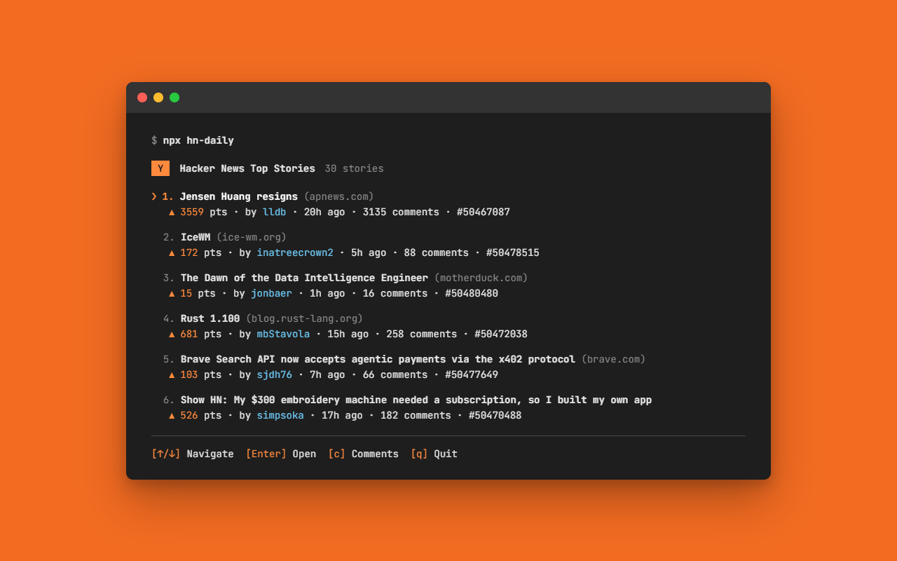

# Hacker News Daily

Read Hacker News in your terminal. Top stories, comment trees, keyword filters and JSON or Markdown output.



## Install

```bash
npx hacker-news-daily
```

or install it globally and use `hn-daily` or the short `hnd` command:

```bash
npm install -g hacker-news-daily
```

Requires Node.js 18 or newer.

## Usage

```
hn-daily                      Today's top 10 stories
hn-daily --top 20             Top 20 stories
hn-daily --new | --best | --ask | --show | --jobs [n]
hn-daily -i                   Browse with the arrow keys
hn-daily comments <id|url>    Read a discussion as a tree
```

| Option | |
| --- | --- |
| `-n, --count <n>` | Number of stories (default 10) |
| `-f, --filter <words>` | Only stories about these words, e.g. `rust,ai` |
| `-i, --interactive` | Browse the list with the keyboard |
| `--json` | Print JSON |
| `--markdown`, `--md` | Print Markdown |
| `-d, --depth <n>` | Reply depth for `comments` |

## Interactive mode

```bash
hn-daily --top 30 -i
```

| Key | |
| --- | --- |
| `↑` `↓` (or `j` `k`) | Move through the list |
| `Enter` | Open the story in your browser |
| `c` | Read the comments, `Esc` to go back |
| `q` | Quit |

Inside the comments view, `o` opens the discussion on news.ycombinator.com and `PgUp` / `PgDn` scroll a page at a time.

## Comments

```bash
hn-daily comments 50478515
hn-daily comments "https://news.ycombinator.com/item?id=50478515" --depth 2
```

Comments are printed as a tree in the same order as on the site.

## JSON and Markdown

```bash
hn-daily --top 20 --json > today.json
hn-daily --show 10 --md > show-hn.md
hn-daily comments 50478515 --json
```

## Data sources

Story lists come from the official [Hacker News API](https://github.com/HackerNews/API). Comment trees come from the [Algolia HN Search API](https://hn.algolia.com/api), which returns a whole discussion in one request. Neither needs an API key.

## License

MIT
